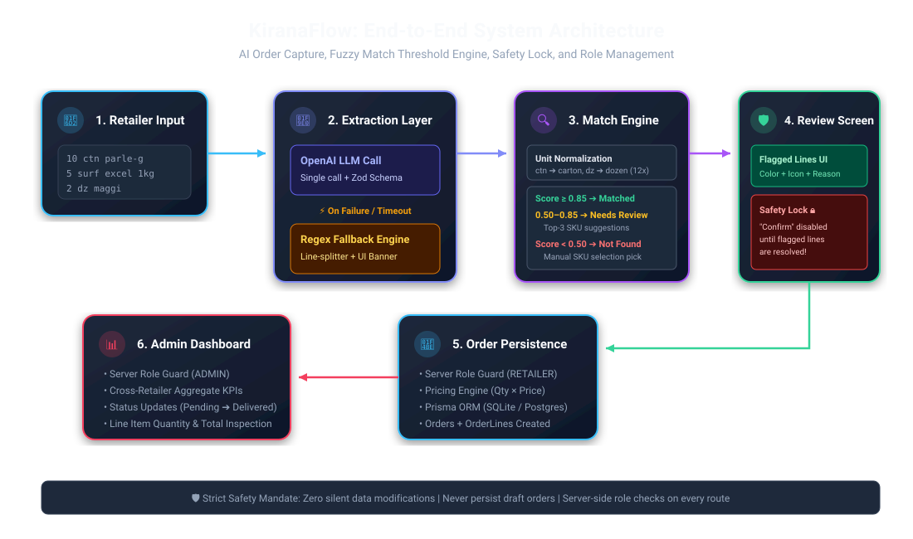
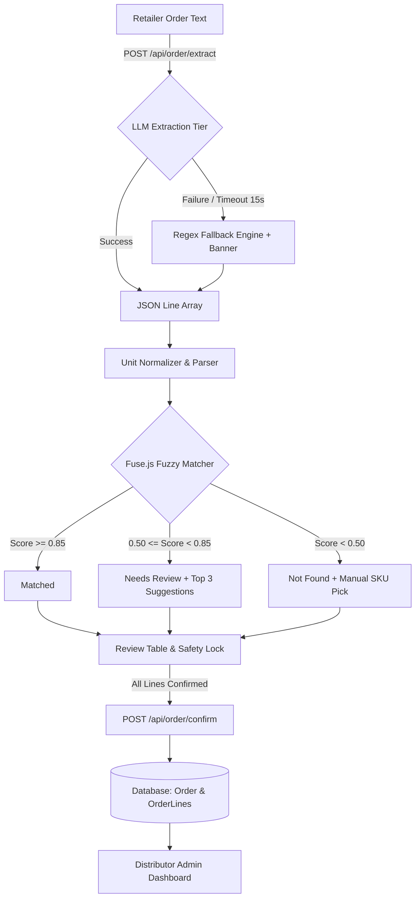
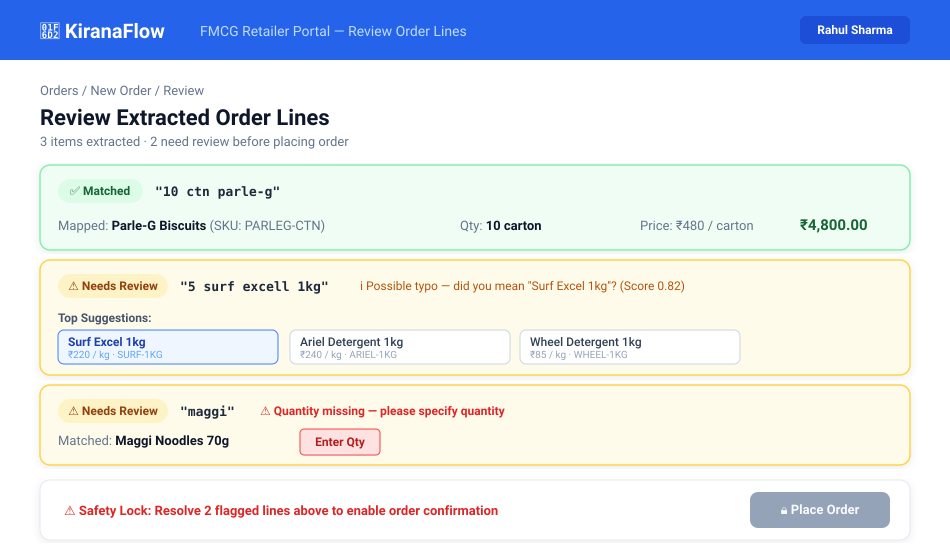

# KiranaFlow 🛒✨

> **Production-Quality FMCG Retailer Ordering App with AI-Powered SKU Capture & Fuzzy Match Intelligence**

KiranaFlow automates the order capture lifecycle between FMCG distributors and neighbourhood retailers (kirana stores). Retailers paste free-text or voice-to-text WhatsApp-style order messages (e.g. *"10 ctn parle-g, 5 surf excel 1kg, 2 dz maggi"*). KiranaFlow uses LLM extraction with strict Zod validation paired with Fuse.js fuzzy matching to reconcile lines against 40+ catalog SKUs, providing confidence scoring, top-3 suggestions, and safety locks before confirmation.

---

## 🏛️ System Architecture





---

## 🖼️ UI Review Screen & Safety Lock



- **Green Rows (`matched`)**: Exact or high-confidence catalog match (`score >= 0.85`).
- **Amber Rows (`needs_review`)**: Moderately confident matches or typos showing **human-readable reason** and **1-click top-3 SKU suggestions**. Also flags missing quantities without guessing.
- **Red Rows (`not_found`)**: Query below threshold (`score < 0.50`) requiring manual selection.
- **Safety Lock 🔒**: The "Place Order" button remains strictly disabled until every flagged line is resolved. Orders are **never** auto-confirmed or persisted in draft states.

---

## 🚀 Key Feature Slices

1. **Dual-Role Authentication & Security (NextAuth.js v5)**
   - Roles: `RETAILER` and `ADMIN` with bcrypt-hashed credentials.
   - Server-side role checks enforced on every route handler and layout via `withAuth` and `requireRole`.
   - Strict tenant boundary: Retailers can strictly only query and view their own orders.

2. **AI Order Capture & Fail-Safe Fallback (`lib/ai/`)**
   - Single-call OpenAI Chat Completion returning strictly validated JSON via Zod (`ExtractedLineSchema`).
   - Automatic single retry on malformed JSON or schema validation mismatches.
   - Fail-safe regex parser fallback with visible UI warning banner (`AIBanner`) when the LLM is offline or times out.

3. **Fuzzy Matching & Confidence Engine (`lib/matching/`)**
   - Inverted Fuse.js scoring (`1 - fuseScore`):
     - `score >= 0.85`: `matched`
     - `0.50 <= score < 0.85`: `needs_review` (with human-readable typo suggestion reason)
     - `score < 0.50`: `not_found`
   - Normalizes units (`ctn`/`carton`, `dz`/`dozen`, `kg`, `g`, `pcs`) with explicit flags on missing quantities.

4. **Pricing Engine (`lib/pricing/`)**
   - Multiplies quantities with unit pricing; automatically handles `dozen` as 12x pieces.
   - Computes line item totals and aggregate order values.

5. **Distributor Admin Dashboard (`app/admin/`)**
   - High-level KPIs: Total orders, pending count, delivered count, revenue.
   - Real-time status progression (`PENDING` ➔ `CONFIRMED` ➔ `PROCESSING` ➔ `SHIPPED` ➔ `DELIVERED` ➔ `CANCELLED`).
   - Drill-down drawer into individual order items and quantities.

---

## 🛠️ Stack & Directory Layout

```
isocode/
├── app/
│   ├── (auth)/login/page.tsx         # Dual role login page
│   ├── admin/orders/page.tsx         # Distributor admin order management & status updates
│   ├── retailer/
│   │   ├── order/new/page.tsx        # Paste order capture & review table
│   │   └── orders/page.tsx           # Retailer's past orders history
│   └── api/
│       ├── order/extract/route.ts    # POST: AI extraction & fuzzy matching
│       ├── order/confirm/route.ts    # POST: Order persistence with role checks
│       ├── order/[id]/status/route.ts# PATCH: Admin status updates
│       └── orders/route.ts           # GET: Scoped orders fetch
├── components/
│   ├── OrderCapture/AIBanner.tsx     # Warning banner when AI fallback triggers
│   ├── ReviewTable/                  # Review rows, suggestions picker, safety lock
│   └── AdminOrderTable/              # Admin orders listing & status badge
├── lib/
│   ├── ai/                           # LLM extraction, zod schema, regex fallback
│   ├── matching/                     # Fuse.js fuzzy matcher & threshold constants
│   ├── pricing/                      # Pricing calculations & dozen multipliers
│   ├── units/                        # Unit normalizer & quantity validator
│   └── auth/                         # NextAuth v5 config & server role guards
├── prisma/
│   ├── schema.prisma                 # Postgres-compatible schema (SQLite locally)
│   └── seed.ts                       # 40 SKUs, 8 retailers, 1 admin, 12 orders
└── __tests__/                        # Vitest suite (52 tests across 5 files)
```

---

## ⚡ Quick Start & Run

### 1. Prerequisites
- Node.js >= 18 (Tested on Node v22.14.0)
- npm >= 9

### 2. Installation & Setup
```bash
# Clone the repository
git clone https://github.com/optimusprimeleader345/KiranaFlow.git
cd KiranaFlow

# Install dependencies
npm install --legacy-peer-deps

# Configure environment variables
cp .env.example .env

# Initialize database, generate client, and seed realistic FMCG catalog
npm run setup
```

### 3. Run Test Suite
```bash
npm test
```
> Runs all 52 Vitest unit tests covering matcher thresholds, unit normalizers, pricing, role guards, and AI fallback edge cases.

### 4. Start Development Server
```bash
npm run dev
```
Open [http://localhost:3000](http://localhost:3000) in your browser.

---

## 🔑 Demo Logins

Pre-seeded credentials with realistic FMCG catalog data:

| Role | Email | Password | Allowed Capabilities |
|---|---|---|---|
| **Retailer** | `demo@retailer.com` | `retailer123` | Paste & AI capture orders, review flagged lines, resolve suggestions, confirm & track own orders |
| **Distributor Admin** | `admin@fmcg.com` | `admin123` | View all retailers' orders, revenue analytics, update order statuses |

---

## 🧪 Comprehensive Vitest Test Matrix (52/52 Passing)

| Test Suite | File | Tests | Coverage Scope |
|---|---|:---:|---|
| **Matcher Thresholds** | `__tests__/matcher.test.ts` | 9 | `matched`, `needs_review`, `not_found`, typos ("surf excell"), Hinglish ("maggi noodl"), top-3 suggestions |
| **Unit Normalizer** | `__tests__/normalise.test.ts` | 20 | Normalization of `ctn`, `dz`, `kg`, `pcs`, `g`, uppercase cases, missing/negative quantity handling |
| **Pricing Engine** | `__tests__/pricing.test.ts` | 9 | Line totals, dozen 12x multiplier calculations, zero/negative bounds, order total aggregation |
| **Role Guard Security** | `__tests__/guards.test.ts` | 5 | Role verification logic, 401 unauthenticated, 403 forbidden role checks |
| **Extractor & Fallback** | `__tests__/extract.test.ts` | 9 | Multi-line parsing, comma/semicolon separators, missing quantity flag, duplicate items, empty input |

---

## 📑 Required Documentation Links
- [ASSUMPTIONS.md](ASSUMPTIONS.md): Explicit log of all design decisions and edge cases.
- [deployment.md](deployment.md): Local run steps, environment variable names, production deploy steps, and TDD architecture outline.
